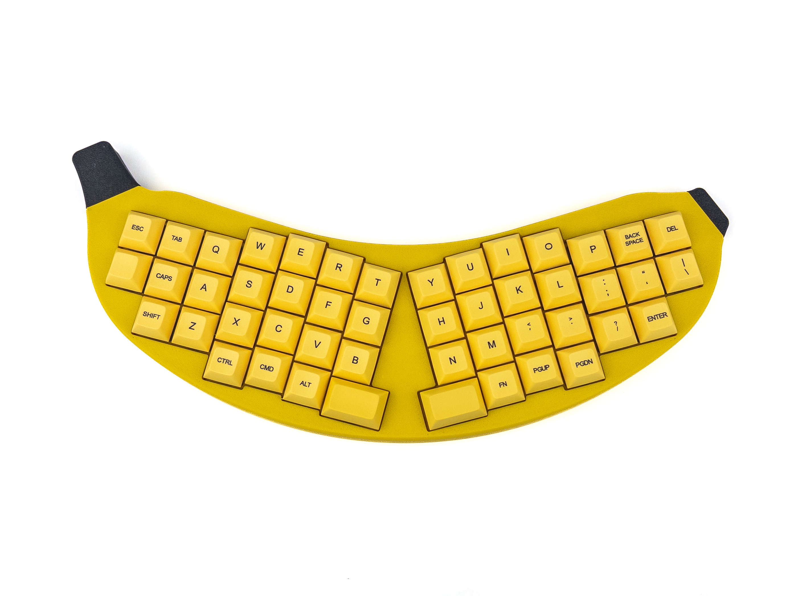

# BANANA-Lite

BANANA-Lite is a modified version of the [BANANA keyboard by RGBKB](https://github.com/RGBKB/Keyboard-files/tree/main/BANANA).

**Get one at [keydapt.com/products/banana-keyboard](https://keydapt.com/products/banana-keyboard).**

## Changes from the original

- **Nav switch removed:** the TM-2028 nav switch and its CNC hat are gone.
- **RGB removed:** the 48 per-key LEDs and 6 underglow LEDs are gone.
- **Magnets:** the case and stand use 9 × 1/4" magnets instead of the original's 11 × 6 mm × 6 mm magnets.

> **Note:** Only `10133.kicad_pcb` was modified. `10133.kicad_sch` is unchanged from the original and still shows the nav switch and RGB components.
## Instructions
Please view the original project for print and build instructions. They are the same.

## License

GPL-3.0, the same license as the original [RGBKB Keyboard-files](https://github.com/RGBKB/Keyboard-files).
